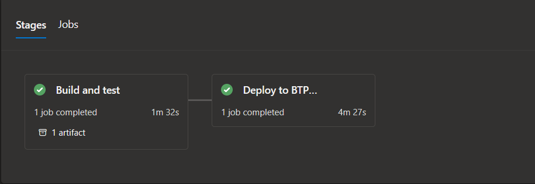
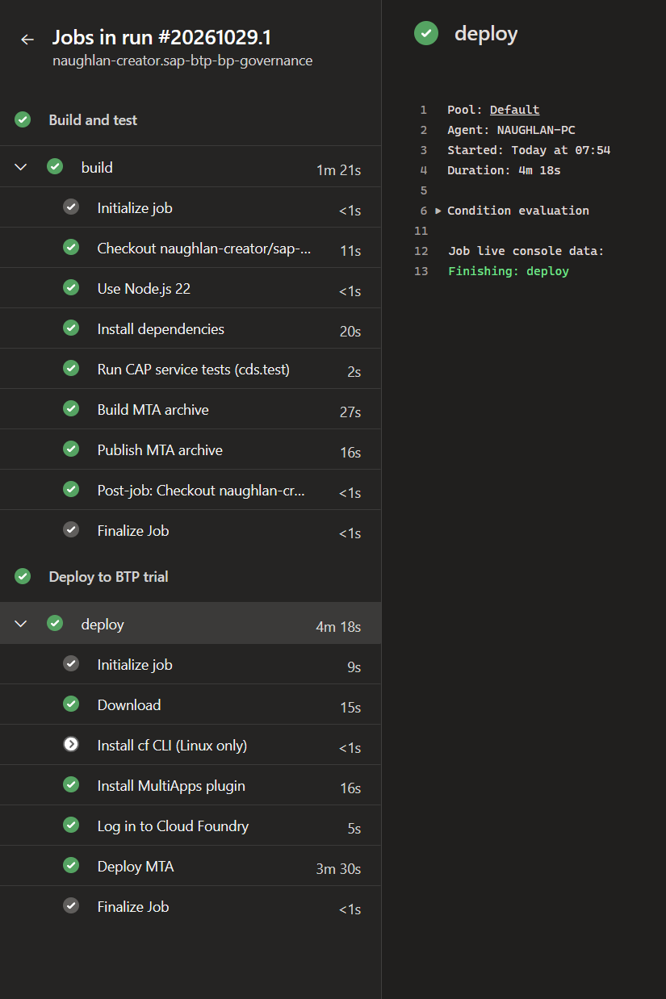
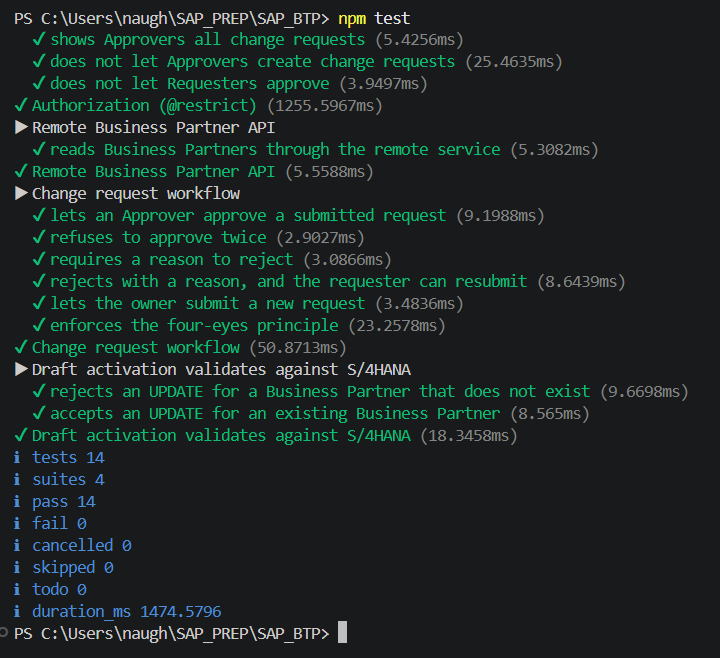
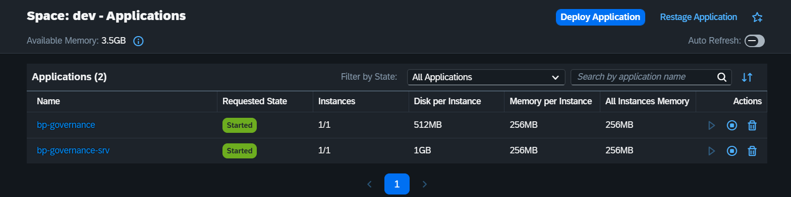
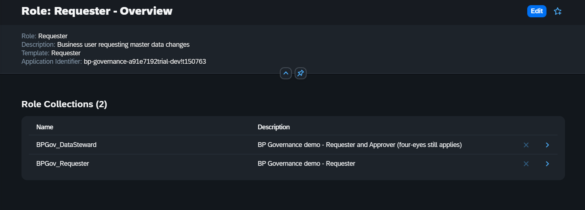
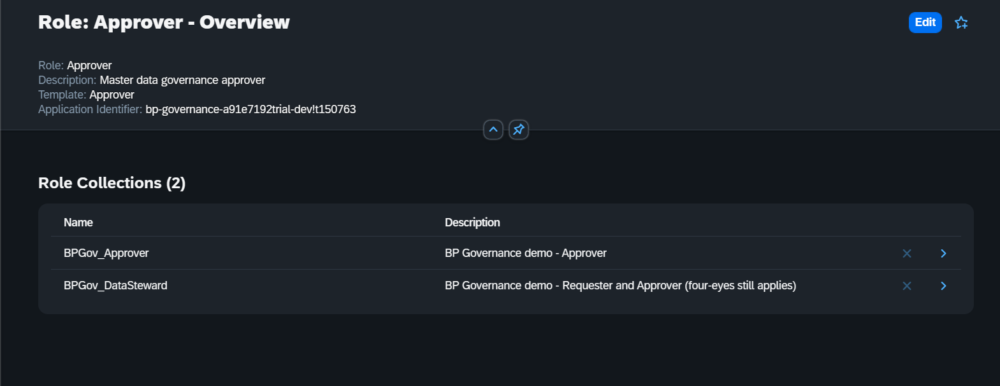
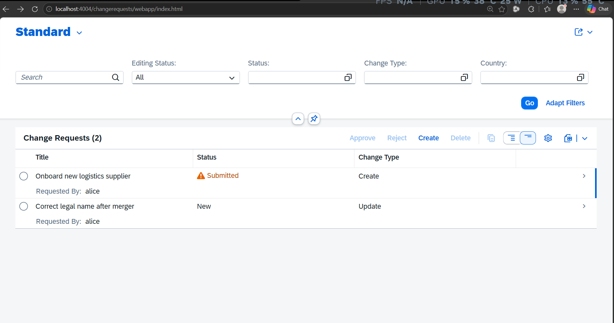
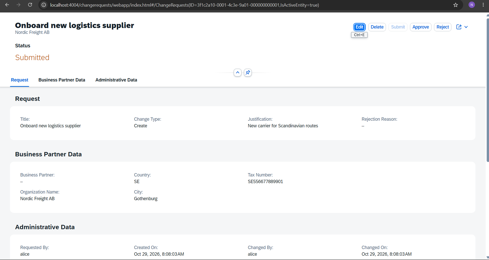

# Screenshots

Evidence that the project builds, passes its tests, deploys to an SAP BTP trial through Azure
Pipelines, and runs. Captured on 29 Oct 2026.

> The Azure DevOps project and the BTP trial subaccount are private. These screenshots stand in
> for access to them.

## 1. CI/CD: Azure Pipelines

Run `#20261029.1`. Both stages are green: *Build and test* produced the MTA archive as an
artifact, and *Deploy to BTP trial* deployed it.

The step-by-step view. Tests run before the MTA is built, so a failing test stops the deploy.
The jobs ran on a self-hosted agent in pool `Default`. *Install cf CLI (Linux only)* is skipped
on purpose on a Windows agent.

## 2. Automated tests

`npm test`: 14 `cds.test` service tests in 4 suites covering `@restrict` authorization, the
remote Business Partner API, the change request workflow (including the four-eyes check), and
validation against S/4HANA on draft activation. 14 pass, 0 fail.

## 3. Deployed on SAP BTP (Cloud Foundry)

BTP cockpit, space `dev`: the approuter (`bp-governance`) and the CAP service
(`bp-governance-srv`) are both *Started*.

## 4. XSUAA roles and role collections

The roles come from the role templates in [xs-security.json](../../xs-security.json). Each role
is in its own role collection, and `BPGov_DataSteward` bundles both.

| Requester | Approver |
|---|---|
|  |  |

## 5. Fiori elements UI

Local run (`npm run watch`, mocked users). The deployed app shows the same UI behind the XSUAA
login.

**List report, logged in as the Requester `alice`.** The `@restrict` rule
`where: 'createdBy = $user'` means alice sees only their own 2 of the 3 requests. *Approve* and
*Reject* are greyed out until a row is selected.

**Object page as an Approver.** The request is *Submitted*, so `Core.OperationAvailable` turns
on *Approve* and *Reject* and turns off *Submit*. The header, the sections and the status colour
come only from annotations in
[annotations.cds](../../app/changerequests/annotations.cds).

